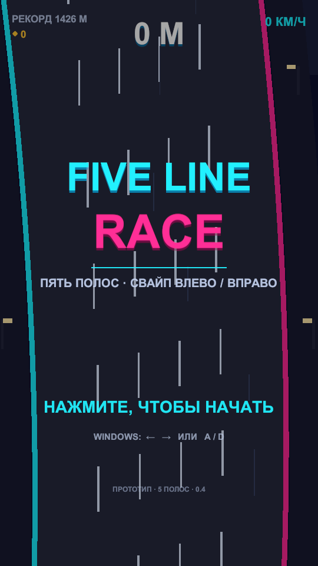
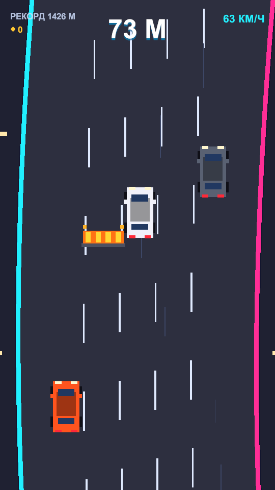

# Five Line Race

Двумерный раннер: плоская графика, вид сверху, **пять полос**.
Всё рисуется кодом из простых прямоугольников — внешних ассетов нет.

Движок: **Unity 6000.5.8f1** (URP, Input System, UGUI).
Пакет Android: `com.falltgames.fiveline`.

| Меню | Заезд |
|---|---|
|  |  |

## Управление

| Действие | Android | Windows |
|---|---|---|
| Перестроиться влево | свайп влево | `←`, `A` или драг мышью влево |
| Перестроиться вправо | свайп вправо | `→`, `D` или драг мышью вправо |
| Начать / повторить | тап | клик, `Пробел`, `Enter`, `R` |
| Выход | кнопка «Назад» | закрыть окно |

## Что в игре

- Машинка едет автоматически, скорость растёт с 54 до 162 км/ч.
- Пять полос, плавный переезд с креном кузова.
- **Повороты трассы**: дорога резко уходит влево и вправо, камера ведёт за поворотом.
- **Сужения и расширения**: дорога становится то уже, то шире, обочины и город раздвигаются вместе с ней.
- Трафик (легковушки, фуры), отбойники, монеты (+25 к счёту).
- Счёт = метры + 25 за монету, рекорд сохраняется (`PlayerPrefs`, ключ `FiveLineRace.Best`).
- Хотя бы две полосы всегда свободны.
- При аварии: тряска камеры, замедление времени, красная вспышка, экран «АВАРИЯ».
- Неоновый ночной город, разметка, фонари, боковые здания — всё процедурное.

## Запуск в редакторе

1. Unity Hub → **Add project from disk** → папка `FiveLineRace`.
2. Открыть в **Unity 6000.5.8f1**.
3. Сцена создастся сама (`Assets/Scenes/FiveLineRace.unity`).
   Если нет — меню **Five Line Race → 1. Настроить проект и открыть сцену**.
4. **Play**.

## Сборка

Из редактора:

- **Five Line Race → 2. Собрать Windows (.exe)**
- **Five Line Race → 3. Собрать Android (.apk)**
- **Five Line Race → 4. Собрать всё (Windows + Android)**

Или батниками (нужна активная лицензия Unity):

```
build_windows.bat
build_android.bat
```

Результаты:

- `Builds/Windows/FiveLineRace.exe`
- `Builds/Android/FiveLineRace.apk` (IL2CPP, ARM64, debug-подпись)

## Структура

```
Assets/Scenes/FiveLineRace.unity     — сцена (камера + объект Game)
Assets/FiveLineRace/Scripts/         — игровой код
  G2Const.cs                           константы, палитра, пять полос
  G2Path.cs                            кривая трассы (повороты)
  G2Ribbon.cs                          гладкие ленты дороги и бортов
  G2Mats.cs                            unlit-материалы (кэш)
  G2Quad.cs                            фабрика плоских прямоугольников
  G2Visuals.cs                         машинки, фуры, отбойники, монеты
  G2World.cs                           трасса, город, прокрутка фона
  G2Input.cs                           Input System / legacy Input
  G2Player.cs                          игрок: полосы, крен, авария
  G2Mover.cs                           движение препятствий и монет
  G2Camera.cs                          тряска камеры
  G2UI.cs                              HUD, меню, экран аварии
  G2Game.cs                            состояния, спавн, счёт
Assets/FiveLineRace/Editor/
  FiveLineRaceBuilder.cs               настройка проекта и сборки
Assets/Settings/                     — URP-профили
```

## Настройка сложности

`Assets/FiveLineRace/Scripts/G2Const.cs`:

- `StartSpeed` / `MaxSpeed` — начальная и максимальная скорость (м/с);
- `Acceleration` — разгон;
- `LaneWidth` — ширина полосы;
- `OrthoSize` — масштаб камеры (больше — видно больше пространства);
- `CurveAmp1` / `CurveFreq1`, `CurveAmp2` / `CurveFreq2` — сила и частота поворотов;
- `WidthFreq` — как часто дорога меняет ширину;
- `WidthNarrow` / `WidthWiden` — насколько дорога сужается и расширяется.

`G2Game.cs` — `SpawnRow()`: сколько полос перекрывать и как часто спавнить ряды.
