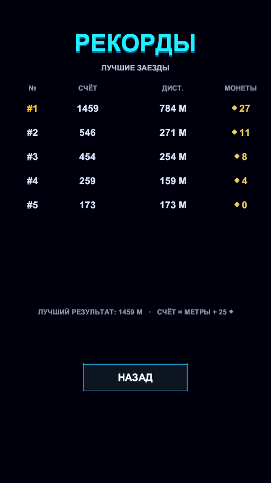
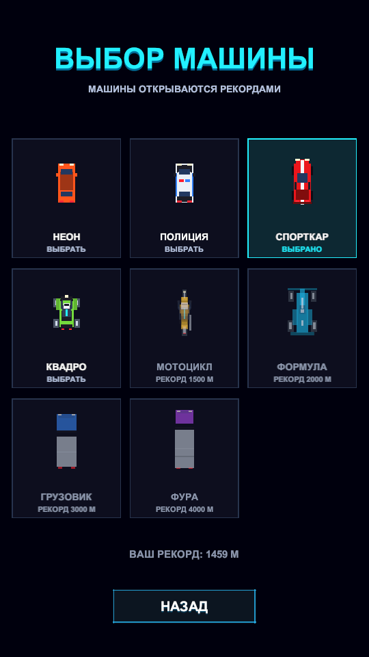

# Five Line Race

Двумерный раннер: плоская графика, вид сверху, **пять полос**.
Всё рисуется кодом из простых прямоугольников — внешних ассетов нет.

Движок: **Unity 6000.5.8f1** (URP, Input System, UGUI).
Пакет Android: `com.falltgames.fiveline`.

| Меню | Заезд |
|---|---|
|  |  |

| Рекорды | Гараж |
|---|---|
|  |  |

## Управление

| Действие | Android | Windows |
|---|---|---|
| Перестроиться влево | свайп влево | `←`, `A` или драг мышью влево |
| Перестроиться вправо | свайп вправо | `→`, `D` или драг мышью вправо |
| Начать / повторить | тап | клик, `Пробел`, `Enter`, `R` |
| Машины / рекорды | кнопки в меню | кнопки в меню |
| Назад из таблицы или гаража | кнопка «Назад» | `Esc` |
| Выход | кнопка «Назад» | закрыть окно |

## Что в игре

- Машинка едет автоматически, скорость растёт с 54 до 162 км/ч.
- Пять полос, плавный переезд с креном кузова.
- **Повороты трассы**: дорога резко уходит влево и вправо, камера ведёт за поворотом.
- **Сужения и расширения**: дорога становится то уже, то шире, обочины и город раздвигаются вместе с ней.
- Трафик (легковушки, фуры), отбойники, монеты (+25 к счёту).
- **Люки на асфальте**: красный +5% скорости, зелёный -5%; эффект плавно сходит на нет.
- **Три жизни на старте** (максимум пять): за каждые 500 м возвращается одна жизнь.
  Жизни показаны покрышками в правом верхнем углу, под спидометром.
- Счёт = метры + 25 за монету, рекорд сохраняется (`PlayerPrefs`, ключ `FiveLineRace.Best`).
- **Таблица рекордов**: восемь лучших заездов со счётом, дистанцией и монетами.
  Открывается из меню и с экрана аварии; после заезда показывается занятое место.
- **Гараж**: восемь машин с разными силуэтами — легковушка, полицейская, спорткар,
  квадроцикл, мотоцикл с гонщиком, болид, средний грузовик и фура. Первая доступна сразу,
  остальные открываются рекордом (250, 600, 1000, 1500, 2000, 3000 и 4000 очков).
  Выбор сохраняется между запусками.
- Хотя бы две полосы всегда свободны.
- Столкновение отнимает жизнь: вспышка, тряска и 1,5 секунды неуязвимости с миганием.
  Когда жизни кончились — замедление времени, перевёрнутая машина и экран «АВАРИЯ».
- Неоновый ночной город, разметка, фонари, боковые здания — всё процедурное.

## Запуск в редакторе

1. Unity Hub → **Add project from disk** → папка `FiveLineRace`.
2. Открыть в **Unity 6000.5.8f1**.
3. Сцена создастся сама (`Assets/Scenes/FiveLineRace.unity`).
   Если нет — меню **Five Line Race → 1. Настроить проект и открыть сцену**.
4. **Play**.

## Сборка

Из редактора:

- **Five Line Race → 2. Собрать Windows (.exe)**
- **Five Line Race → 3. Собрать Android (.apk)**
- **Five Line Race → 4. Собрать всё (Windows + Android)**

Или батниками (нужна активная лицензия Unity):

```
build_windows.bat
build_android.bat
```

Результаты:

- `Builds/Windows/FiveLineRace.exe`
- `Builds/Android/FiveLineRace.apk` (IL2CPP, ARM64, debug-подпись)
- `Builds/Android/FiveLineRace-<версия>-<код>.apk` — копия с версией в имени

## Версии и обновление APK

Версия хранится в одном месте — `Assets/FiveLineRace/Resources/version.txt`:

```
0.7.0
13
```

- первая строка — имя версии (`versionName`), её меняют вручную;
- вторая строка — код сборки (`versionCode`), он **увеличивается на 1 при каждой сборке**
  и сразу подставляется в настройки Android;
- в меню игры снизу показывается текущая версия, например `0.7.0 (13)`.

Благодаря растущему коду новый APK ставится поверх установленного, данные и рекорд
сохраняются. Важно, чтобы все APK были подписаны одним ключом: сейчас используется
debug-ключ Unity с этой машины, поэтому обновления работают при сборке здесь же.
Для переноса сборок на другой компьютер подключите собственный keystore
(**Project Settings → Player → Publishing Settings**).

## Рекорды и гараж

- Таблица рекордов хранится в `PlayerPrefs`, ключ `FiveLineRace.Records`
  (JSON, до 10 заездов; на экране — восемь лучших). Сортировка по счёту,
  при равенстве — по дистанции.
- Выбранная машина — ключ `FiveLineRace.Car`.
- Каталог машин и пороги открытия — `Assets/FiveLineRace/Scripts/G2Cars.cs`:
  `НЕОН` (сразу), `ПОЛИЦИЯ` (250), `СПОРТКАР` (600), `КВАДРО` (1000),
  `МОТОЦИКЛ` (1500), `ФОРМУЛА` (2000), `ГРУЗОВИК` (3000), `ФУРА` (4000).
  Порог сравнивается с рекордом. Скорость и управление у всех одинаковые,
  отличаются силуэт, цвет и размер кузова (у грузовиков и фуры он длиннее).
- Геометрия машин — `Assets/FiveLineRace/Scripts/G2VehicleArt.cs`: один и тот же
  набор прямоугольников рисует машину в заезде и превью в гараже.

## Структура

```
Assets/Scenes/FiveLineRace.unity     — сцена (камера + объект Game)
Assets/FiveLineRace/Scripts/         — игровой код
  G2Const.cs                           константы, палитра, пять полос
  G2Version.cs                         версия из Resources/version.txt
  G2Path.cs                            кривая трассы (повороты)
  G2Ribbon.cs                          гладкие ленты дороги и бортов
  G2Mats.cs                            unlit-материалы (кэш)
  G2Quad.cs                            фабрика плоских прямоугольников
  G2Visuals.cs                         машинки, фуры, отбойники, монеты, люки
  G2World.cs                           трасса, город, прокрутка фона
  G2Input.cs                           Input System / legacy Input
  G2Player.cs                          игрок: полосы, крен, авария
  G2Mover.cs                           движение препятствий, монет и люков
  G2Manhole.cs                         тип люка (ускорение / замедление)
  G2Cars.cs                            каталог машин и выбранная машина
  G2VehicleArt.cs                      силуэты машин из прямоугольников
  G2Records.cs                         таблица рекордов в PlayerPrefs
  G2Camera.cs                          тряска камеры
  G2UI.cs                              HUD, меню, рекорды, гараж, экран аварии
  G2Game.cs                            состояния, спавн, счёт
Assets/FiveLineRace/Editor/
  FiveLineRaceBuilder.cs               настройка проекта и сборки
Assets/Settings/                     — URP-профили
```

## Настройка сложности

`Assets/FiveLineRace/Scripts/G2Const.cs`:

- `StartSpeed` / `MaxSpeed` — начальная и максимальная скорость (м/с);
- `Acceleration` — разгон;
- `LaneWidth` — ширина полосы;
- `OrthoSize` — масштаб камеры (больше — видно больше пространства);
- `CurveAmp1` / `CurveFreq1`, `CurveAmp2` / `CurveFreq2` — сила и частота поворотов;
- `WidthFreq` — как часто дорога меняет ширину;
- `WidthNarrow` / `WidthWiden` — насколько дорога сужается и расширяется;
- `ManholeSpeedStep` — шаг люка (0.05 = 5%);
- `SpeedMulMin` / `SpeedMulMax` — пределы накопленного эффекта люков;
- `SpeedMulReturn` — как быстро эффект люков сходит на нет;
- `StartLives` / `MaxLives` — жизни на старте и максимум;
- `LifeEveryMeters` — через сколько метров возвращается жизнь;
- `InvulnerableTime` — неуязвимость после удара (секунды).

`G2Game.cs` — `SpawnRow()`: сколько полос перекрывать и как часто спавнить ряды.
